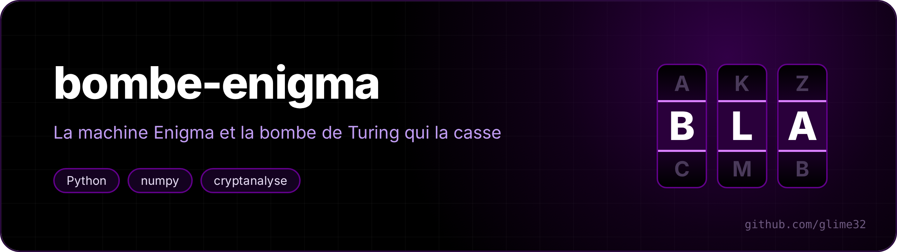

<p align="center"></p>

<p align="center"> </p>

An **Enigma** machine (Wehrmacht model I / M3), and the attack that broke it during the war: the **Turing-Welchman bombe**, rewritten in Python with numpy.

<p align="center"><a href="README.fr.md">🇫🇷 Version française</a></p>

The attack only needs the ciphertext and a **crib**: a piece of plaintext you can guess. The Germans sent a weather report every morning that always started the same way; here, `BULLETINMETEO` ("weather report" in French). From that alone, the program recovers **the rotor order, their positions, the rings and the plugboard**, then decrypts everything.

The program talks French (`réglage secret` = secret key, `fiches` = plugs, `arrêts` = stops):

```
$ python3 bombe.py demo --graine 1
(56 message(s) écarté(s) : leur menu avait moins de 3 boucles)

réglage secret : rotors I-II-IV, réflecteur B, anneaux ZHN, départ FVF, fiches AH DI EJ GZ KR MY NS PT QV UW

message chiffré (148 lettres) :
TJITU UEHNT UVEUP GSKGT DRHGE UTHTH RRQKZ ECPLU OXQRZ BONJD WVYSK UNGYC FAOKU HEAYX ...

on suppose que le message commence par « BULLETINMETEO ».

menu : 13 arêtes, 12 lettres, 3 boucle(s) autour de la lettre testée
  bombe : 60/60 ordres, 40 arrêt(s) vérifié(s) en 48.4 s

BULLE TINME TEODU MATIN CIELD EGAGE SURLE SECTE URNOR DVENT FAIBL EDESU DMERC ALMEC ONDIT IONSF AVORA
BLESP OURLA SORTI EPREV UEAVA NTLAU BECON FIRME RLARE CEPTI ONDEC EMESS AGE

148/148 lettres justes, 49.5 s au total
```

## Usage

`chiffrer` = encrypt, `attaquer` = attack, `anneaux` = rings, `fiches` = plugboard.

```sh
pip install numpy                     # the only dependency
python3 bombe.py demo                 # random secret key, encryption, attack
python3 bombe.py chiffrer --rotors "II IV V" --anneaux "B U L" --positions "L E S" \
        --fiches "AV BS CG DL FU HZ IN KM OW RX" "Bulletin météo"
python3 bombe.py attaquer --crib BULLETINMETEO message.txt
python3 tests.py                      # 10 checks in one second
```

Encrypting and decrypting are the same operation (Enigma is an involution). The machine is checked against known cases: `AAAAA` with rotors I-II-III at AAA gives `BDZGO`, and the sequence `ADU → ADV → AEW → BFX` shows the famous "double step" of the middle rotor. `tests.py` also decrypts a real German message from 1941 (Operation Barbarossa), then runs the bombe on a single rotor order and 1,500 positions to check that it stops at the right place.

## The machine

A letter goes through the plugboard (plugs that swap pairs of letters), three rotors, a reflector, the three rotors backwards, and the plugboard again. Before each letter, the right rotor turns one notch; when it passes its notch, it carries the middle one, which carries the left one.

Two consequences the attack relies on:
- **a letter is never encrypted to itself** (because of the reflector). So the program rules out straight away the positions where the crib would put a letter in front of itself;
- only the `position − ring` offset of each rotor matters for the wiring: the bombe can search for the rotors without knowing the rings.

## The bombe

**The menu.** The crib is lined up under the ciphertext: `B` facing `N`, `U` facing `L`... Each pair is an edge of a graph, labelled by its position. If `a` is connected to `x` by the plugboard, then at position `i`, `b` is connected to `Sᵢ(x)`, where `Sᵢ` is the rotor permutation at that moment.

**Hypothesis and contradiction.** For one starting position of the rotors, assume a plug for the most connected letter of the menu, and propagate the consequences along the edges. Welchman's **diagonal board** adds symmetry (`a ↔ x` is the same as `x ↔ a`), which carries the information much further. If the hypothesis is wrong, the "current" ends up lighting all 26 wires of one letter: contradiction, the position is ruled out. Otherwise it's a **stop**.

**With numpy.** All 17,576 starting positions are tested together: a boolean array of shape `(17576, 26, 26)`, where `M[n, a, x]` means "at position n, a is connected to x". An edge becomes a single vectorised operation (`M[:, b, :] |= M[lignes, a, Sᵢ]`), the diagonal board an `M | M.transpose(0, 2, 1)`. Contradictory positions are dropped as they appear.

**The middle rotor's step.** The real bombe assumed the middle rotor didn't move during the crib, and missed some messages because of it. Here every moment where it could step is tried: 13 times more work. Only the "double step" (the middle rotor also carrying the left one) isn't handled.

**Loops.** A loop in the menu (a letter that comes back to itself by another path) is a test that wrong positions almost always fail. Without a loop, the bombe stops everywhere and is useless: just like at Bletchley Park, the program refuses such a menu and asks for a longer crib, or one placed elsewhere.

**Finishing.** A stop gives the rotor offsets and part of the plugboard. The program then tries the compatible rings, goes back to the start of the message (running the rotors backwards), and scores each decryption with **French bigram** statistics learned from [`corpus.txt`](corpus.txt). The 1,500 best candidates get their plugboard completed by hill climbing (plug or unplug each pair of free letters as long as the text gets more "French"); the 10 best then get a joint rings + plugboard search, and a two-move search.

The key found can differ from the real one in its rings and positions while being **equivalent**: it gives exactly the same text. Only the offsets matter for the wiring, and the left ring has no visible effect.

## Results

On 10 random secret keys (`demo --graine 1` to `10`, 8 cores):

| | |
|---|---|
| message fully recovered | **9 / 10** |
| time per attack | 47 to 68 s |
| stops to sort out | 6 to 351 |

The failure (seed 2) is a case the real bombe missed too: during the 13 letters of the crib, the middle rotor does its "double step" and carries the left one, which the bombe's model doesn't allow for.

What the failed runs taught me, now fixed:
- with an incomplete plugboard, the statistical score sometimes picks the right ring one notch off (one or two wrong letters every 26): so the rings are searched together with the plugboard, on the best candidates;
- hill climbing on the plugboard can get stuck when two plugs need to change at once: the finalists get a two-move search;
- only the loops in the menu component where the hypothesis is made are useful. With fewer than 3 loops, thousands of stops remain: the demo skips those messages, as Bletchley Park did.

## Orders of magnitude

The real bombe tested the 17,576 positions of one rotor order in about twenty minutes, and 60 orders had to be tried. Here, in vectorised Python on 8 cores, the 60 orders and the 13 possible steps of the middle rotor take about a minute.
